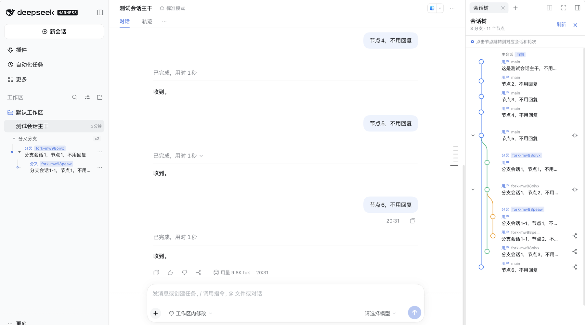
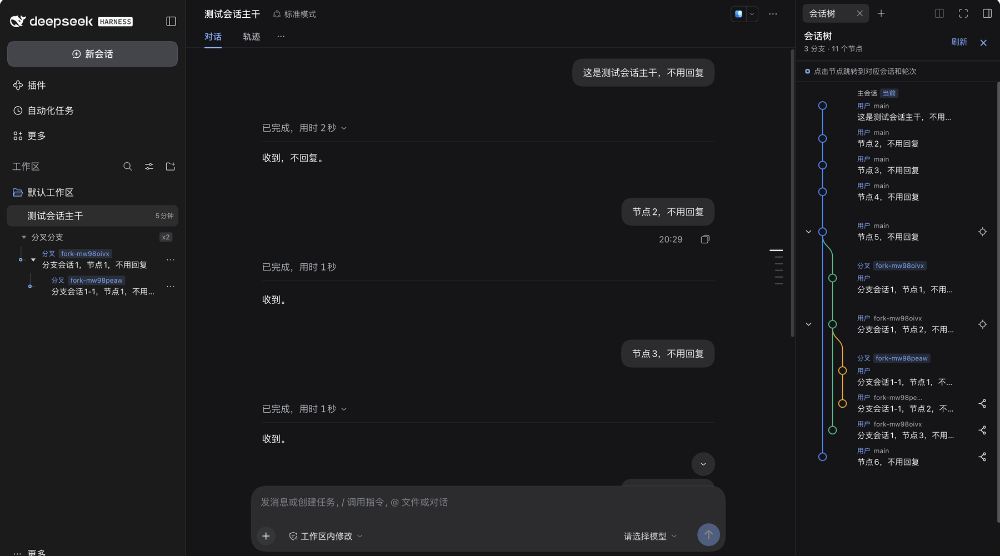
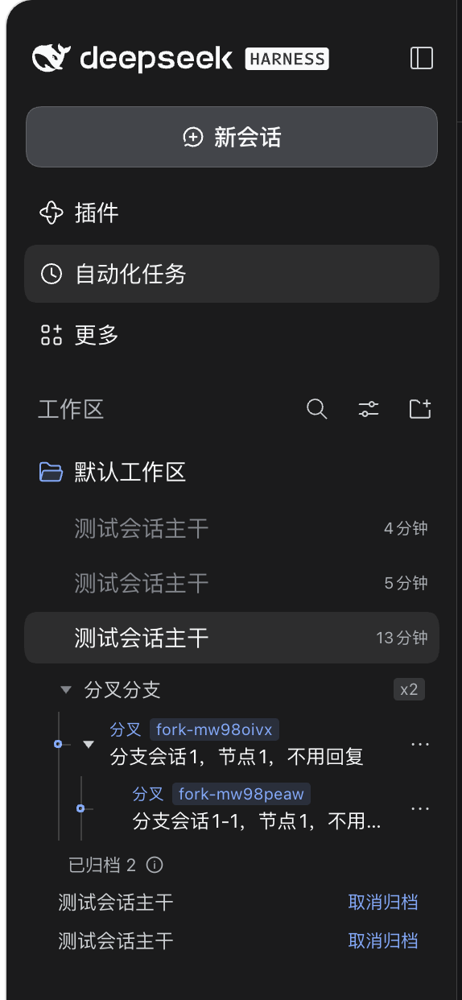
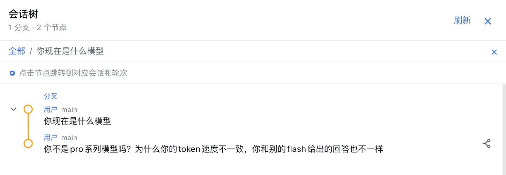
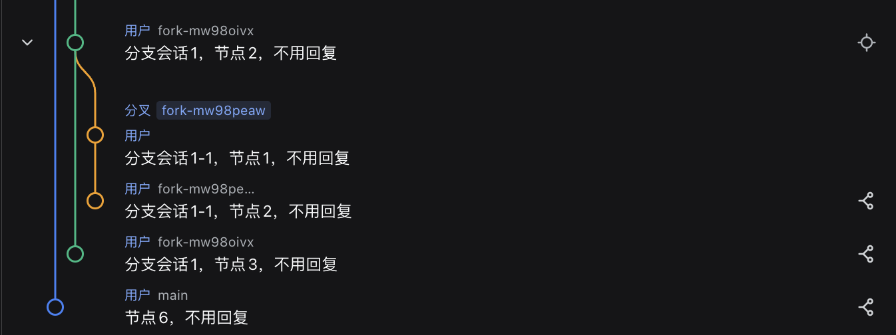
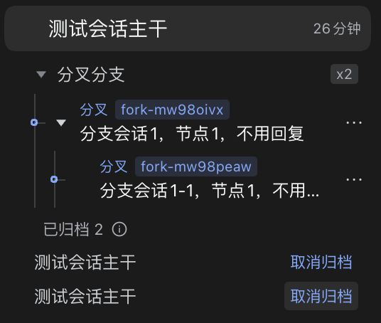

# dsh-session-tree

[](https://www.npmjs.com/package/@ryanlee2007/dsh-session-tree)
[](https://github.com/lizhuoyuan41-droid/dsh-session-tree-extension/actions/workflows/ci.yml)
[](./LICENSE)
[](https://github.com/deepseek-ai/deepseek-harness)

Append-only, multi-branch conversation trees for
[DeepSeek-Harness](https://github.com/deepseek-ai/deepseek-harness) — fork any
historical node, clone a branch into a new session, and browse the whole
lineage as one merged WebUI graph. Old history is never edited or deleted.

This is the **v0.1.0 release** of this repository. It is based on the upstream
[robiteame/dsh-session-tree-extension](https://github.com/robiteame/dsh-session-tree-extension)
project; the original copyright notice and the full MIT license text are
retained in [LICENSE](./LICENSE).

Three commands:

| Command | What it does |
|---|---|
| `/tree` | Open the merged lineage graph: every non-subagent session and node, clickable and bindable |
| `/fork` | Branch from any historical node — the fork appears in the graph and as an inline menu under its source session |
| `/clone` | Duplicate the current conversation into an independent new session under the same project |

## v0.1.0 highlights

- **Subtree focus**: click the target icon on any fork point to show only that
  node and its descendants. The focused node pins to the top, the view is
  remembered across Session switches/sidebar remounts, and navigating inside
  the subtree keeps the focus. `全部` / Esc returns to the whole lineage.
- **Readable branch names**: a fork is named from its first own prompt, then
  follows later dynamic titles; an empty fork falls back to
  `parent · fork N`.
- **Stable colours**: each branch keeps the colour of its permanent branch
  number, including after archiving an outer branch or focusing a subtree.
- **Nested lanes**: a fork of a fork sits at `parent lane + 1`.
- **Animated branch menus**: every level opens/closes with height + fade and
  becomes inert when closed; the sidebar no longer scrolls horizontally.

## Screenshots

Tree panel (light and dark) with the sidebar's inline fork-branch menu:





The inline `/fork` branch menu beneath its source session:



Subtree focus with the `全部 / node` breadcrumb and the focused node pinned to
the top:



A fork of a fork sits at `parent lane + 1` instead of jumping inward:



Archived nested branches stay under the top-level session's menu and are named
after their immediate parent Session:



Distributed as four npm-format packages under the `@ryanlee2007` scope:

| Package | Role |
|---|---|
| [`@ryanlee2007/dsh-session-tree`](./packages/bundle/session-tree) | Carrier Bundle: one install mounts everything below through its composition layer |
| [`@ryanlee2007/dsh-pi-agent-session-tree`](./packages/extensions/pi-agent-session-tree) | Host domain service: the `SessionTree`/`SessionTreeStore` domain model and the `sessionTree` Remote |
| [`@ryanlee2007/dsh-tool-session-tree`](./packages/extensions/tool-session-tree) | Command surface: the `/tree` `/fork` `/clone` commands |
| [`@ryanlee2007/dsh-client-ui-session-tree`](./packages/client/ui-session-tree) | WebUI tree panel: a native tab in the Harness 0.2 right Sidebar, with an additive overlay fallback for older stock builds |

## Install (users)

### DeepSeek Harness Desktop

Open **Settings → Plugins → Market**, search for
`@ryanlee2007/dsh-session-tree`, install it, and restart the desktop app. The
desktop plugin manager activates the carrier bundle, so the next boot composes
the three rows (`pi-agent-session-tree`, `tool-session-tree`,
`ui-session-tree`) that load the Host service, the commands, and the browser
panel.

On desktop builds whose `dsh plugin` command only forwards to pnpm, install
through the in-app market; current builds activate a newly installed bundle
directly. After the restart, `/tree` opens the panel.

### CLI (`0.2.2-rc.1` and newer)

On a CLI that ships the `0.2.2-rc.1` plugin manager, one command installs and
activates the bundle:

```sh
dsh plugin --profile <profile> add @ryanlee2007/dsh-session-tree
```

Prebuilt tarballs install the same way and need no build scripts:

```sh
dsh plugin --profile <profile> add ryanlee2007-dsh-session-tree-0.1.1.tgz
```

After installing, restart the profile. Verify the composed layer:

```sh
dsh --profile <profile> --dump-config   # should list the three session-tree rows
```

Requires DeepSeek-Harness `^0.2.2-rc.1` and Cordis `~4.1.0`; the target
installation provides those peers. The current development and verification
baseline is `0.2.2-rc.1`. No install
scripts run — the tarballs ship prebuilt `lib/` artifacts.

## The three commands

### `/tree` — open the tree panel

`/tree` opens the right-side panel as one merged graph for the current
session's lineage: ancestors, forks, and clones appear in a single git-style
view, with user messages, assistant replies, tool calls, and model switches
shown as connected nodes. Shared copied prefixes are deduplicated, fork points
carry session badges, and the current session's path stays highlighted. Click
a node to bind it; clicking a node owned by another session opens that session
first. Collapse individual subtrees or whole session branches; use the focus target
to isolate one fork point.

### `/fork` — branch from any historical node

`/fork` picks an earlier user prompt and grows a new branch from there: the
conversation continues along the new path while the original one stays intact.
The fork is created through the official native fork API, so it appears in the
session list with real parent linkage. The plugin adds the new branch to the
merged graph and also renders it as an inline collapsible menu directly beneath
its source session's row. Both views follow the official reactive session list,
so new branches appear without a refresh.

### `/clone` — duplicate into a new session

`/clone` copies the current conversation — through its root path — into an
independent Session under the same project. The source history stays
read-only; the clone is yours to continue separately.

## Branch switching and graceful degradation

The plugin never modifies Harness core files. It capability-detects the
optional branch-selection engine API at runtime:

- **Native mode** — on a checkout carrying
  [`dev/session-branch-surface.patch`](./dev/session-branch-surface.patch)
  (`Session.selectMessageSurface()`), jump/fork switch the model-visible
  history directly: the next turn genuinely starts from the new branch.
- **Stock mode** — on an unmodified official Harness, the plugin emulates the
  switch through official append APIs (an empty `replace` surface event) plus a
  plugin-owned sidecar under `$DSH_HOME/storages/session-tree/` for durable
  branch state. The log stays resume-valid.
- **Projection mode** — if even the emulation is unavailable, navigation moves
  the tree projection and panel only, and the next turn keeps the canonical
  history.

Every mode is honest about itself: the Host log prints a one-time notice when
a session runs in a non-native mode. Move the raw `session.jsonl.zstd` between
machines together with the matching sidecar file.

## How it works

- **Append-only** — every node is immutable; branching and jumping only move
  the cursor. Old branches are never edited or deleted.
- **Every entry is a node** — messages, tool calls, model switches, compaction
  records, and branch summaries all become typed nodes; each has a unique
  `nodeId` and a `parentId` (root is `null`). A node may have multiple
  children — that is the fork.
- **Cursor navigation** — jumping moves the active leaf to a historical node;
  the next append grows a new branch from there. Sibling branches stay intact.
- **LLM context** — the model always receives the standard `messages` array
  for the root→cursor path only.

## Development (contributors)

The repository is a pnpm workspace building the three implementation packages
standalone (no Harness checkout needed):

```sh
pnpm install
pnpm verify      # build + typecheck (host & client) + pack dry-run + vitest
pnpm pack:all    # produce the four tarballs
```

Tests run against the published Harness packages (`0.2.2-rc.1`) — the
stock-mode paths — with `vitest` from the repository root. The
browser spec in `packages/client/ui-session-tree` exercises both the 0.2 native
right-Sidebar registration and the older overlay fallback in the standalone
suite.

### Source integration against a Harness checkout

For debugging against a Harness source checkout (native branch switching and
source integration):

```sh
dev/install.sh /path/to/deepseek-harness     # applies both dev patches + copies packages
cd /path/to/deepseek-harness && pnpm install && pnpm run build
```

See [`dev/README.md`](./dev/README.md) for what each patch does. This flow is
for contributors only and is not required for normal installs. User installs
never touch a Harness checkout.

## License

MIT.
